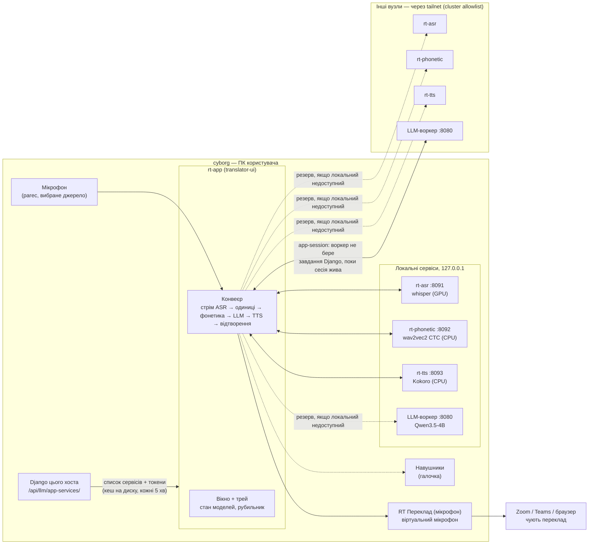
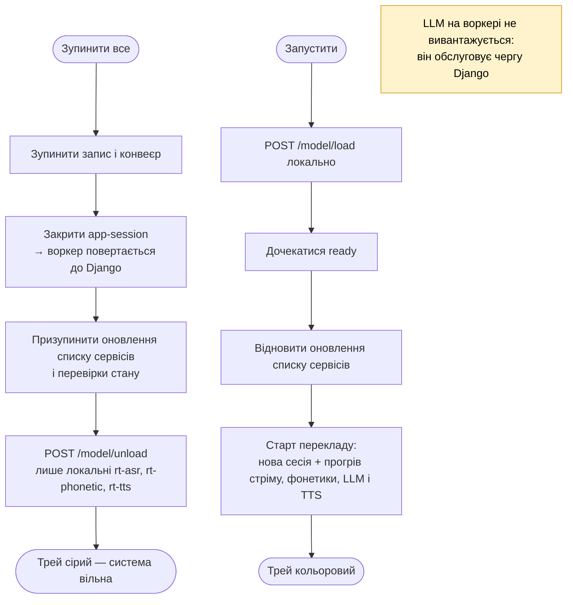
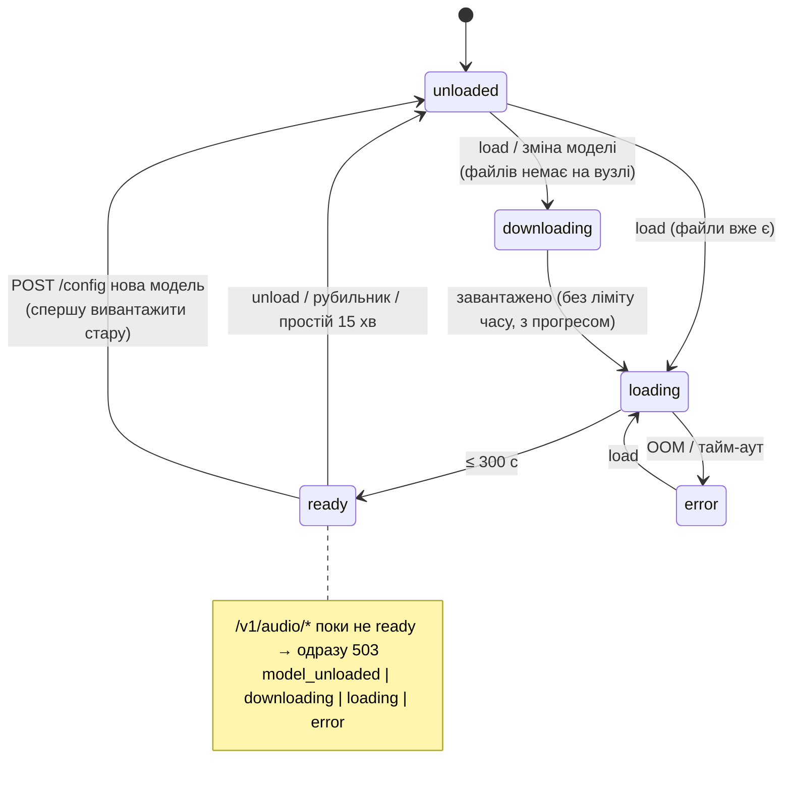

# Повний ланцюжок перекладу — діаграми

Стан на 2026-11-01 (rt-edge: стрім rt-asr, одночасний переклад одиницями,
фонетична перевірка кожної одиниці rt-phonetic і переклад «зі звуком» —
[специфікація](superpowers/specs/2026-10-31-streaming-asr-simultaneous-translation.md)
§8, [`phonetic-bench-2026-11-01.md`](../context/phonetic-bench-2026-11-01.md),
[`live-test-2026-10-31.md`](../context/live-test-2026-10-31.md) §17).
Детальний опис налаштувань — [`USAGE.md`](USAGE.md).

## 1. Компоненти та зв'язки



Вибір вузла для кожного виду сервісу — `services.use.<kind>` (auto /
конкретний вузол; для фонетики ще «вимкнено»). Локальні сервіси — завжди
127.0.0.1; tailnet-адреси — лише для інших вузлів.

## 2. Шлях однієї одиниці перекладу

```mermaid
sequenceDiagram
  autonumber
  participant M as Мікрофон (parec, 48 кГц)
  participant E as Edge: рівень + 16 кГц
  participant WH as rt-asr WS (whisper, LocalAgreement-2)
  participant PH as rt-phonetic (HTTP, CTC)
  participant U as Стадія одиниць (SourceLedger)
  participant L as LLM-воркер
  participant G as Перевірка відповіді
  participant T as rt-tts (Kokoro)
  participant P as Відтворення (pacat)

  M->>E: блоки аудіо
  Note over E: нормалізація рівня (до −20 dBFS, ≤ +24 дБ, лімітер);<br/>тихо ≥ 3 с мови → «Мікрофон тихий»
  E->>WH: PCM16 кадрами по 100 мс (копія — у кільці стріму)
  WH-->>U: final (зафіксовані слова з часом, лише дописуються),<br/>partial (незафіксований хвіст), endpoint (тиша ≥ 800 мс)
  Note over U: хвіст після курсора + partial — сірим в UI, не озвучується
  U->>U: одиниця: кінець речення / endpoint /<br/>≥ 12 слів на межі клаузи (,;:) / 20 слів<br/>(крапка + мала літера без паузи - не кінець; шматок 1 слово < 0.25 с - до сусіда;<br/>речення в кінці зафіксованого чекає ≤ 0.5 с;<br/>шматок ≤ 3 слів без крапки на endpoint - до наступної одиниці)
  alt у тексті немає літер
    U-->>U: пропуск (asr_no_words)
  end
  U->>PH: аудіо одиниці [t0, t1] (wav 16 кГц),<br/>бюджет 0.5 с + 0.25 с/с аудіо (1.5..4 с)
  alt тайм-аут / помилка / 409 (немає моделі мови)
    PH-->>U: лише whisper (phonetic_timeout / phonetic_unavailable /<br/>«фонетика недоступна для <мови>»), подія в журналі UI
  else транскрипт літерами
    PH-->>U: «нова модель перевірятиме віспер» + час слів
    alt порожньо (тиша, шум) → no_word<br/>або схожість літер < 0.4 → disagree
      U-->>U: відкинуто до LLM (gate_dropped), ledger просто йде далі
    end
  end
  opt «Записувати сесію для аналізу»
    U-->>U: seg-N.wav + рядок phrases.jsonl (phonetic, similarity, gate, mode)
  end
  U->>L: system: інструкції «зі звуком»; контекст — попередні пари<br/>user: SOUND: літери фонетики / TEXT: whisper /<br/>NEXT (do not translate): решта зафіксованого + partial
  L-->>G: переклад (частинами: речення, довге — по клаузах ≥ 4 слів)
  alt ≤ 3 слів оригіналу
    G-->>G: дочекатися всієї відповіді
  end
  Note over G: один INFO-рядок на прохід LLM: whisper, phonetic (similarity, мс),<br/>гейт, режим (sound / whisper-only / retry), NEXT, переклад
  alt задовго, кирилиця, мета-коментар (meta) або витік NEXT
    alt режим sound і в TTS ще нічого не пішло
      G->>L: один повтор лише з whisper (retry_whisper_only)
    else
      G-->>U: відхилено (llm_rejected; після озвучки — rejected_after_tts),<br/>у контекст не йде
    end
  else норма
    G->>T: частина за частиною
    Note over T: черга відтворення > 4 с → швидкість ×1.05..1.25<br/>(крок на частину); < 2 с → tts.speed
    T->>P: аудіо по порядку (тиша по краях обрізана: 50 / 150 мс)
    P->>P: вибраний вихід (віртуальний мікрофон)<br/>+ навушники, якщо увімкнено
  end
```

Одиниці не перетинаються: що озвучено, те не виправляється і не
повторюється (рішення власника 2/3). Затримки на одиницю — у
`get_stats()["latency"]` (p50/p90: `commit_ms` кінець слова → фіксація,
`llm_first_ms`, `tts_first_ms`, `ready_ms` кінець мови → звук готовий,
`e2e_ms` кінець мови → початок відтворення) і в INFO-рядку
`speech end -> …`; офлайн-стенди — `python -m scripts.pipeline_bench`
(USAGE §8) і `python -m scripts.replay_session` (записана сесія через
гейт і LLM).

SOUND (літери, що реально прозвучали; імена й терміни — як чути:
«сайборг», «ес кей топ», «віспер») — основа перекладу; TEXT (whisper) —
лише правопис, межі слів і числа: як підказка SOUND не допомагав —
впевнені помилки whisper виживали. На старті конвеєра — прогрів усіх
сервісів паралельно: стрім `WS /v1/audio/stream` rt-asr (аудіо тим часом
чекає в кільцевому буфері, ≤ 30 с), rt-phonetic (модель + 1 с тиші), LLM і
TTS — по одному короткому запиту. Без фонетики (вимкнено / недоступна —
видно в UI) LLM отримує лише текст whisper зі звичайним промптом, а
відсікання галюцинацій не діє. rt-phonetic тримає одну модель однієї мови
(`uk-wav2vec2-stress`): польська/російська — «фонетика недоступна для
<мови>», лише whisper; модель перемикає тільки користувач (вкладка
«Фонетика»).

## 3. Рубильник «Зупинити все й звільнити пам'ять»



## 4. Стани моделі в rt-asr / rt-phonetic / rt-tts


