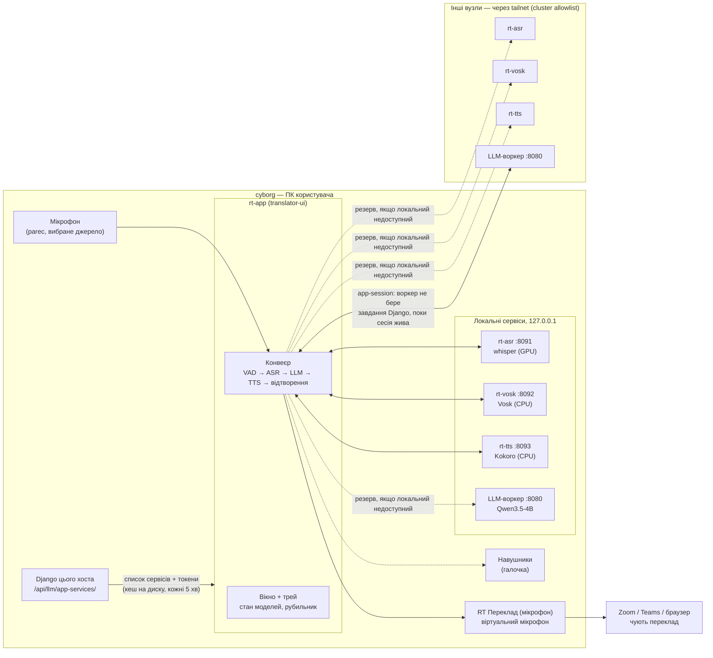
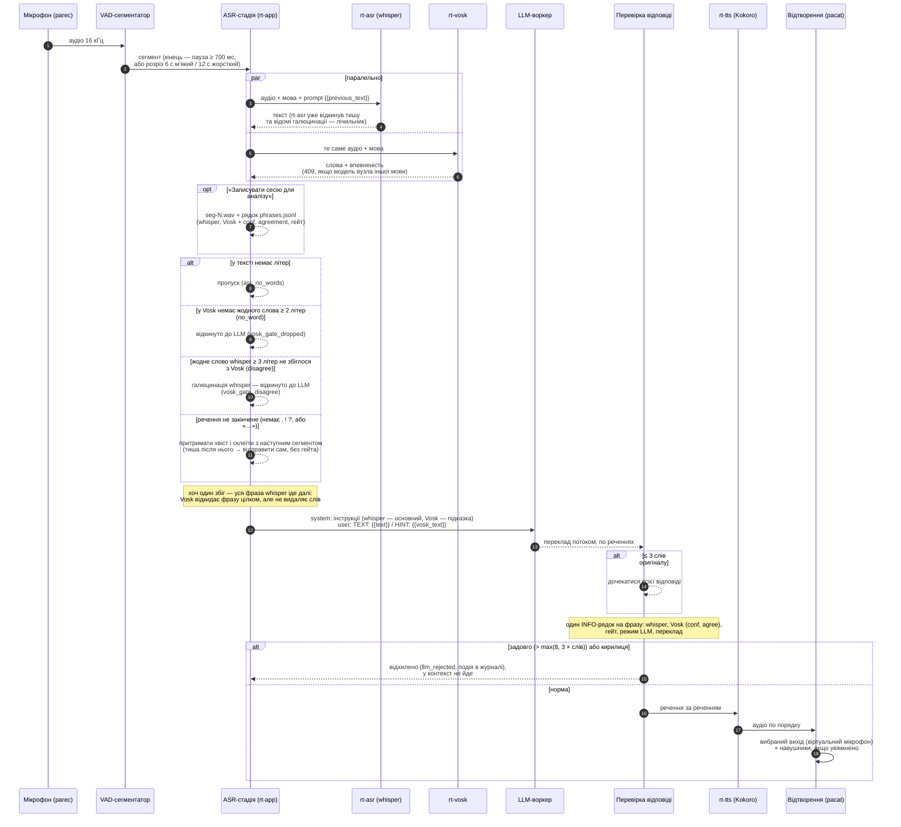
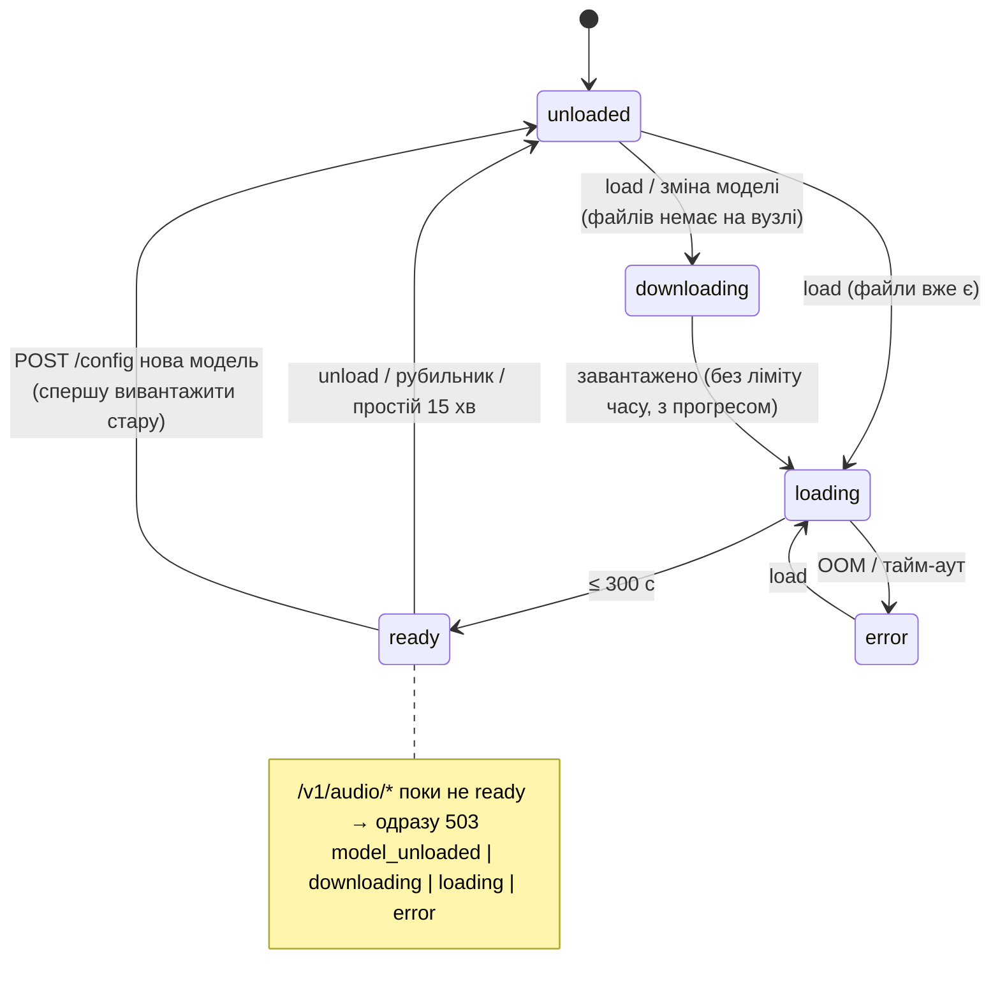

# Повний ланцюжок перекладу — діаграми

Стан на 2026-10-31 (rt-edge: гейт на рівні сегмента, whisper основний текст для LLM —
[`live-test-2026-10-31.md`](../context/live-test-2026-10-31.md) §10). Детальний опис налаштувань —
[`USAGE.md`](USAGE.md).

## 1. Компоненти та зв'язки

Вибір вузла для кожного виду сервісу — `services.use.<kind>` (auto /
конкретний вузол; для Vosk ще «вимкнено»). Локальні сервіси — завжди
127.0.0.1; tailnet-адреси — лише для інших вузлів.

## 2. Шлях однієї фрази

TEXT (whisper) перекладається повністю; HINT (Vosk) лише виправляє
слова, які whisper розчув неправильно, а слова HINT поза TEXT не
перекладаються. На старті конвеєра — прогрів усіх сервісів паралельно:
відкриття стрімів `WS /v1/audio/stream` rt-asr і rt-vosk (аудіо тим часом
чекає в кільцевому буфері стріму, ≤ 30 с), LLM і TTS — по одному короткому
запиту. Без Vosk (вимкнено / недоступний — видно в UI) LLM отримує лише
текст whisper зі звичайним промптом, а відсікання за Vosk не діє. rt-vosk тримає
одну модель однієї мови: фраза іншою мовою — недоступний «немає моделі для
«<мова>»» (лише whisper); модель перемикає тільки користувач (вкладка
«Звірка (Vosk)», «Завантажити модель для «<мова>»»).

## 3. Рубильник «Зупинити все й звільнити пам'ять»

## 4. Стани моделі в rt-asr / rt-vosk / rt-tts

