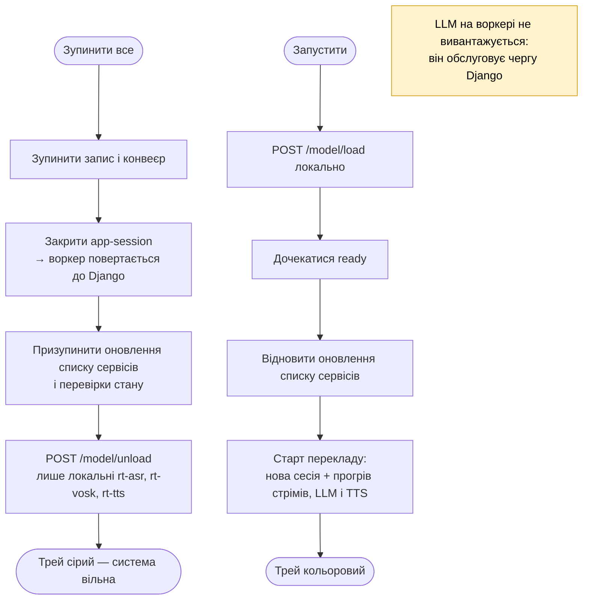
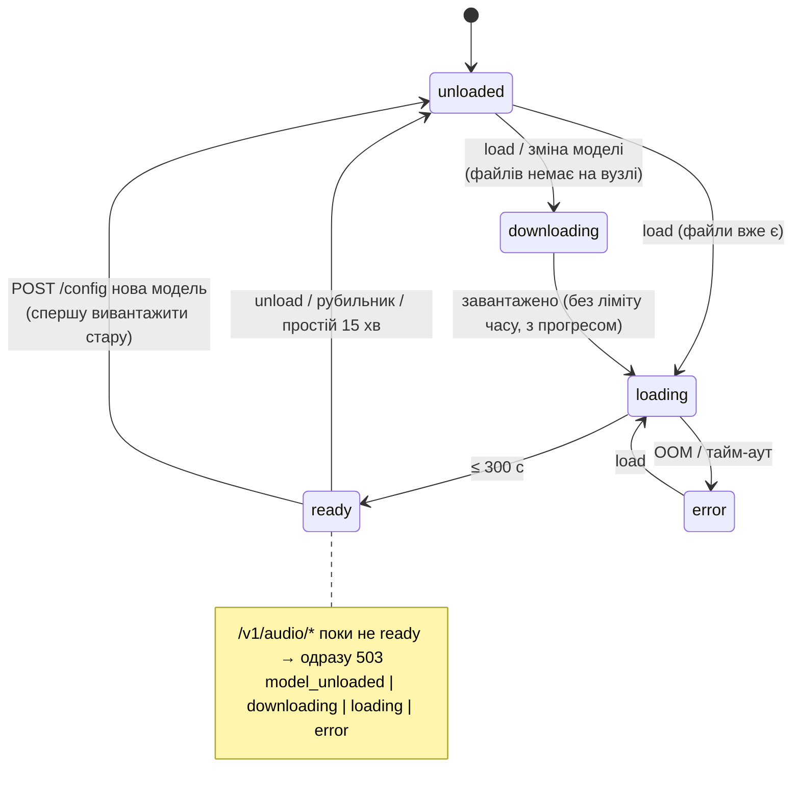

# Повний ланцюжок перекладу — діаграми

Стан на 2026-10-31 (rt-edge: стріми rt-asr/rt-vosk, одночасний переклад
одиницями, гейт Vosk на одиницю —
[специфікація](superpowers/specs/2026-10-31-streaming-asr-simultaneous-translation.md),
[`live-test-2026-10-31.md`](../context/live-test-2026-10-31.md) §10, §13).
Детальний опис налаштувань — [`USAGE.md`](USAGE.md).

## 1. Компоненти та зв'язки


Вибір вузла для кожного виду сервісу — `services.use.<kind>` (auto /
конкретний вузол; для Vosk ще «вимкнено»). Локальні сервіси — завжди
127.0.0.1; tailnet-адреси — лише для інших вузлів.

## 2. Шлях однієї одиниці перекладу

```mermaid
sequenceDiagram
  autonumber
  participant M as Мікрофон (parec, 48 кГц)
  participant E as Edge: рівень + 16 кГц
  participant WH as rt-asr WS (whisper, LocalAgreement-2)
  participant VK as rt-vosk WS (Kaldi)
  participant U as Стадія одиниць (SourceLedger)
  participant L as LLM-воркер
  participant G as Перевірка відповіді
  participant T as rt-tts (Kokoro)
  participant P as Відтворення (pacat)

  M->>E: блоки аудіо
  Note over E: нормалізація рівня (до −20 dBFS, ≤ +24 дБ, лімітер);<br/>тихо ≥ 3 с мови → «Мікрофон тихий»
  par ті самі кадри по 100 мс в обидва стріми
    E->>WH: PCM16
    WH-->>U: final (зафіксовані слова з часом, лише дописуються),<br/>partial (незафіксований хвіст), endpoint (тиша ≥ 500 мс)
  and
    E->>VK: PCM16
    VK-->>U: final / partial зі словами (conf, start, end),<br/>idle{at, silent_from} (у Kaldi немає слова і аудіо без голосу — тиша)
  end
  Note over U: хвіст після курсора + partial — сірим в UI, не озвучується
  U->>U: одиниця: кінець речення / endpoint /<br/>≥ 12 слів на межі клаузи (,;:) / 20 слів<br/>(крапка + мала літера без паузи - не кінець; шматок 1 слово < 0.25 с - до сусіда;<br/>речення в кінці зафіксованого чекає ≤ 0.5 с)
  U->>U: чекати ≤ 300 мс, доки Vosk покриє кінець одиниці<br/>(інакше лише whisper — vosk_late)
  alt у тексті немає літер
    U-->>U: пропуск (asr_no_words)
  else Vosk покрив кінець (словами або idle - тиша) і: жодного слова ≥ 2 літер (no_word)<br/>або ≥ 2 слова ≥ 3 літер і жодного збігу (disagree)
    U-->>U: відкинуто до LLM (vosk_gate_dropped), ledger просто йде далі
  else Vosk без слів 2 одиниці поспіль (≥ 3 слів whisper)
    U-->>U: «Vosk не чує — звірка вимкнена до відновлення»,<br/>далі лише whisper, поки не повернуться слова Vosk
  end
  opt «Записувати сесію для аналізу»
    U-->>U: seg-N.wav + рядок phrases.jsonl
  end
  U->>L: system: інструкції; контекст — попередні пари<br/>user: TEXT: одиниця / HINT: слова Vosk її відрізка /<br/>NEXT (do not translate): решта зафіксованого + partial
  L-->>G: переклад (частинами: речення, довге — по клаузах ≥ 4 слів)
  alt ≤ 3 слів оригіналу
    G-->>G: дочекатися всієї відповіді
  end
  Note over G: один INFO-рядок на одиницю: whisper, Vosk (conf, agree),<br/>гейт, режим LLM, NEXT, переклад
  alt задовго, кирилиця або витік NEXT
    G-->>U: відхилено (llm_rejected, подія в журналі),<br/>у контекст не йде
  else норма
    G->>T: частина за частиною
    T->>P: аудіо по порядку (тиша по краях обрізана: 50 / 150 мс)
    P->>P: вибраний вихід (віртуальний мікрофон)<br/>+ навушники, якщо увімкнено
  end
```

Одиниці не перетинаються: що озвучено, те не виправляється і не
повторюється (рішення власника 2/3). Затримки на одиницю — у
`get_stats()["latency"]` (p50/p90: `commit_ms` кінець слова → фіксація,
`llm_first_ms`, `tts_first_ms`, `ready_ms` кінець мови → звук готовий,
`e2e_ms` кінець мови → початок відтворення) і в INFO-рядку
`speech end -> …`; офлайн-стенд — `python -m scripts.pipeline_bench`
(USAGE §8).

TEXT (whisper) перекладається повністю; HINT (Vosk) лише виправляє
слова, які whisper розчув неправильно, а слова HINT поза TEXT не
перекладаються. На старті конвеєра — прогрів усіх сервісів паралельно:
відкриття стрімів `WS /v1/audio/stream` rt-asr і rt-vosk (аудіо тим часом
чекає в кільцевому буфері стріму, ≤ 30 с), LLM і TTS — по одному короткому
запиту. Без Vosk (вимкнено / недоступний — видно в UI) LLM отримує лише
текст whisper зі звичайним промптом, а відсікання за Vosk не діє. rt-vosk тримає
одну модель однієї мови: фраза іншою мовою — недоступний «немає моделі для
«<мова>»» (лише whisper); модель перемикає тільки користувач (вкладка
«Звірка (Vosk)», «Завантажити модель для «<мова>»»).

## 3. Рубильник «Зупинити все й звільнити пам'ять»



## 4. Стани моделі в rt-asr / rt-vosk / rt-tts


